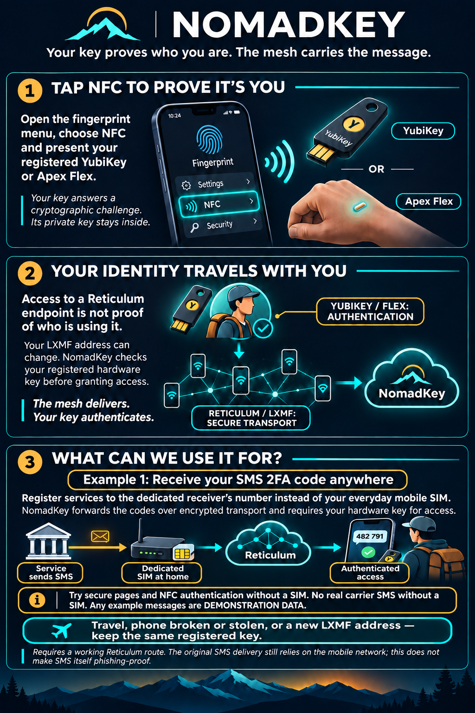

# NomadKey Android Server

**Keep your SMS receiver at home. Use your hardware key to access private pages wherever you have a Reticulum connection.**

NomadKey Host turns a spare Android phone into a secure NomadNet page server and SMS receiver. It works with the separate NomadKey addition to Columba, which supplies the NFC key reader. The server handles authentication, permissions and protected content.

## Two separate parts

| Item | Purpose |
| --- | --- |
| [NomadKey for Columba](https://github.com/TheBeadster/NomadKey/tree/columba/nomadkey-development) | Adds NFC hardware-key authentication to Columba's NomadNet browser. |
| NomadKey Android Server (this project) | Hosts protected pages, verifies hardware-key proofs and provides access to Android-visible SMS. |

An LXMF address identifies a messaging endpoint; it does not prove which person is using it. Reticulum provides encrypted transport. Your registered YubiKey or Apex Flex authenticates you to NomadKey by proving control of an approved credential. A different trusted phone or a fresh LXMF address can be used, subject to the server's enrollment and access rules. The hardware key's private key stays inside it.

## Why I developed it

I travel a lot and now keep my authenticator credentials and passkeys on a YubiKey. If my phone breaks, gets lost or is stolen, I still have those credentials on my separate key.

SMS 2FA is more awkward. If I lose my SIM while abroad, getting a replacement can take a long and inconvenient time. SIM swapping is another concern.

My solution is to keep the SIM used for SMS 2FA safely at home in an old Android phone dedicated to receiving messages and making them available over Reticulum to authenticated endpoints. Services must send their codes to that SIM's number instead of the SIM in my everyday phone.

The server lets authenticated users read Android-visible SMS on protected pages. Registered endpoints default to sender/time alerts without message contents. Current development builds also offer owner-controlled full-message delivery; receiving apps may retain delivered messages. Protected-page access expires after five minutes even while browsing; Forget me ends it sooner.

## Try it on an old Android phone

You can try the backend server on any old Android phone you have. You only need a SIM if you want to receive and forward SMS 2FA codes.

## How it fits together



The infographic is a conceptual overview. Real SMS requires an active receiving SIM and mobile service. Android may restrict access to OTP messages. Hardware, carrier reception and delivery need checking separately on the actual devices. Keeping the SIM at home does not prevent a carrier-side SIM swap. Reticulum needs a working route, and delivery before a code expires is not guaranteed.

This remains a development project. Use a trusted client phone and app, verify the genuine service, and keep a separately enrolled backup key.

## Latest development downloads

| App | Direct APK download |
| --- | --- |
| Columba with NomadKey NFC | [Columba 2.3.1-beta dev19](https://github.com/TheBeadster/NomadKey/releases/download/nomadkey-20261119-dev/NomadKey-Columba-2.3.1-beta-dev19.apk) |
| Android SMS / secure-page server | [NomadKey SMS Server 0.2-dev27](https://github.com/TheBeadster/NomadKey/releases/download/nomadkey-20261119-dev/NomadKey-SMS-Server-0.2-dev27.apk) |

[Release notes and validation limits](https://github.com/TheBeadster/NomadKey/releases/tag/nomadkey-20261119-dev) · [SHA-256 checksums](https://github.com/TheBeadster/NomadKey/releases/download/nomadkey-20261119-dev/SHA256SUMS.txt)

These are development builds, not official upstream Columba or production releases. Update the matching NomadKey development app in place to preserve identities and enrollment; do not uninstall to bypass an update error. The Columba APK is universal, including S24-compatible arm64 support.

You can try the backend server on any old Android phone you have. You only need a SIM if you want to receive and forward SMS 2FA codes.

The [Android Host guide](docs/ANDROID-HOST.md) documents the earlier Host setup baseline. See the current release notes above for exact APK versions, checks and source-provenance limitations. Columba source is maintained on [its separate branch](https://github.com/TheBeadster/NomadKey/tree/columba/nomadkey-development).

## Technical explanation

Reticulum provides authenticated encrypted transport. FIDO2 separately proves control of an enrolled credential; the administrator assigns its permissions. A session is bound to the genuine service, the requesting link and client public key, a fresh challenge, permitted actions and an absolute expiry. It is not a general identity allowlist.

## Implemented

- Python FIDO2 verifier and native CTAP2 client using Yubico python-fido2.
- Session authority bound to one identified RNS link, its client public key, service identity, permissions and server lifetime.
- Five-minute absolute server expiry using a monotonic clock; single-use 60-second challenges, fail-closed content checks, Forget me and fresh credential-removal authorization.
- Columba 2.3.1-beta normal Announces and NomadNet browser integration: public login page, fingerprint-menu NFC authentication, normal Micron rendering, countdown and Forget me. Protected content bypasses browser caches, history and tab restoration. Uses Columba's configured Python RNS transport and Android ISO-DEP NFC.
- Automatic NFC type detection: normal blank NDEF tags share a public site address without a PIN; FIDO keys use the existing PIN-protected bookmark flow. Shared tags never replace trusted pins. See [dev8](docs/ANDROID_DEV8.md).
- NFC saved-site read/write flow, portable full destination/public-key pins and a Saved NFC sites menu. Requires compatible protected FIDO2 storage; see [status](docs/STATUS.md) for hardware coverage. See [NFC bookmarks](docs/NFC_BOOKMARKS.md).
- Trusted local public-credential import; no network first-user enrollment or reset.
- Standalone PC NFC CLI. MeshChatX UI integration and PC hardware work deferred after the user requested server/Columba priority while away from the PC.

## Local development

```sh
python -m venv .venv
.venv/bin/pip install -e '.[test]' -r requirements-server.txt
.venv/bin/python -m pytest -q
.venv/bin/python scripts/network_smoke.py
```

Windows uses `.venv\Scripts\python` and `.venv\Scripts\pip`. PC NFC additionally needs `.[pc]` and a PC/SC reader driver. The network smoke test opens a temporary loopback TCP Reticulum listener on port 44221 and uses an ephemeral **software** authenticator. It does not access production content.

See [protocol and threat model](docs/PROTOCOL.md), [integration decisions](docs/INTEGRATION.md), [installation and rollback](docs/OPERATIONS.md), and [hardware checklist](docs/HARDWARE.md). Documentation is prepared for eventual publication; GitHub Pages is not enabled.

The [dev3 Android guide](docs/ANDROID_DEV3.md) describes the normal-browser flow. The older separate development launcher remains available for trusted enrollment.

[Dev6](docs/ANDROID_DEV6.md) keeps NFC reader mode active until you move the key away and explicitly confirm the return to the site. Background revocation remains enabled.

