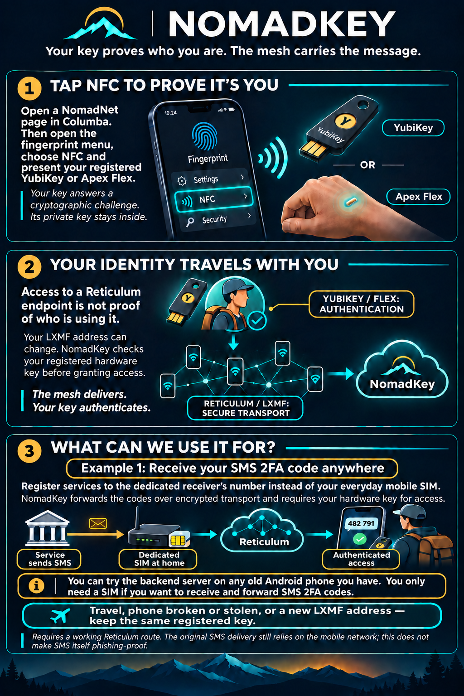

# NomadKey for Columba

**NFC hardware-key authentication for NomadNet pages.**

NomadKey is an addition to Columba. It adds an **NFC key reader** to the fingerprint menu in Columba's NomadNet browser, allowing you to authenticate with a registered **YubiKey or Apex Flex**.

## Latest development downloads

| App | Direct APK download |
| --- | --- |
| Columba with NomadKey NFC | [Columba 2.3.1-beta dev19](https://github.com/TheBeadster/NomadKey/releases/download/nomadkey-20261119-dev/NomadKey-Columba-2.3.1-beta-dev19.apk) |
| Android SMS / secure-page server | [NomadKey SMS Server 0.2-dev27](https://github.com/TheBeadster/NomadKey/releases/download/nomadkey-20261119-dev/NomadKey-SMS-Server-0.2-dev27.apk) |

[Release notes and validation limits](https://github.com/TheBeadster/NomadKey/releases/tag/nomadkey-20261119-dev) · [SHA-256 checksums](https://github.com/TheBeadster/NomadKey/releases/download/nomadkey-20261119-dev/SHA256SUMS.txt)

These are development builds, not official upstream Columba or production releases. Update the matching NomadKey development app in place to preserve identities and enrollment; do not uninstall to bypass an update error. The Columba APK is universal, including S24-compatible arm64 support.

You can try the backend server on any old Android phone you have. You only need a SIM if you want to receive and forward SMS 2FA codes.

## What is it for?

An LXMF address identifies a messaging endpoint. It does not prove who is holding the phone. NomadKey adds a separate check using an approved hardware key.

Reticulum securely transports the data; your hardware key proves control of the credential registered with the service. You can use a different trusted phone or a new LXMF address, subject to the server's enrollment and access rules, without treating that address as your password.

## What do I need?

- A NomadKey-enabled development build of Columba and a compatible NFC Android phone.
- A supported FIDO2 NFC key, such as a YubiKey or Apex Flex, enrolled with the service.
- A reachable NomadNet server running the NomadKey authentication backend. An ordinary static NomadNet page alone cannot verify the key and grant access.

Open the server's NomadNet page in Columba. Then open the fingerprint menu, choose NFC and follow the PIN/key prompts. The server checks a fresh cryptographic proof before granting temporary access. The private key stays inside the authenticator. Identify alone does not unlock protected pages.

## Example: SMS 2FA while travelling

The separate [NomadKey Android Server](https://github.com/TheBeadster/NomadKey) can keep your SMS receiving SIM at home and provide authenticated access to codes over Reticulum. This is one use of NomadKey; NFC authentication can protect other private pages too.

You can try the backend server on any old Android phone you have. You only need a SIM if you want to receive and forward SMS 2FA codes.

This is a NomadKey development addition, not an official upstream Columba release. The existing Columba README and development notes follow below.

---

  

# Columba

Columba is a simple messaging and voice app for the [Reticulum](https://github.com/markqvist/Reticulum) network on Android. Send [LXMF](https://github.com/markqvist/LXMF) messages and make [LXST](https://github.com/markqvist/LXST/tree/master/LXST) voice calls without relying on the internet, cell towers, or any central servers.

Built with a native Android interface and Material Design 3, Columba brings mesh networking to your pocket in a familiar, easy-to-use package.

</img> </img> </img>

## What You Can Do

- **Message without infrastructure** - Send messages even when the internet is down or unavailable
- **Connect multiple ways** - Use Bluetooth LE to connect to those around you anywhere, Wifi for those at home, LoRa radio via [RNode](https://github.com/markqvist/RNode_Firmware) for those at a distance, or use TCP to connect to any Reticulum server around the world 
- **Stay private** - End-to-end encryption with no accounts, no tracking, and no central servers
- **Share location** - Share your location securely with others, viewable from a dedicated map
- **Download maps for offline use** - Download or import map files. Supports vector and raster, in MBTiles format
- **Browse NomadNetwork** - Access nomadnet pages over Reticulum networks
- **Build your network** - Help relay traffic for others and expand the mesh
- **Keep your identity** - Generate your messaging identity right on your device
- **Manage multiple identities** - Easily swap between multiple identities
- **Export and import identities** - Keep an external backup of your keys, or migrate to a new device. Import from other Reticulum clients like [Sideband](https://github.com/markqvist/Sideband)
- **Share your identity via QR Code** - Built in QR code scanner and generator for sharing your identity with others
- **Custom Color Themes** - Don't like the default colors? Rice to your heart's content! 

## Getting Started

Download the latest release from [Releases](https://github.com/torlando-tech/columba/releases) and install on your Android device. See [SECURITY.md](./SECURITY.md) for APK verification instructions.

Alternatively, you can download the apk via [NomadNet](https://github.com/markqvist/NomadNet) at `8d1788fdb4e9f85303cfdf7481e721c7:/page/index.mu`

## About Reticulum

[Reticulum](https://github.com/markqvist/Reticulum) is a networking stack that lets devices communicate directly with each other, forming resilient mesh networks. It is optimized for low bandwidth, high latency connections, and can communicate over nearly any medium. Columba uses [LXMF](https://github.com/markqvist/LXMF) (Lightweight Extensible Message Format) to send messages across the Reticulum network, and uses a native Android implementation of [ble-reticulum](https://github.com/torlando-tech/ble-reticulum) to enable messaging over BLE with other Android and Linux devices.

Want to learn more? Visit [Reticulum's documentation](https://reticulum.network/).

## Why "Columba"

Columba, latin for "dove," is a [constellation](https://en.wikipedia.org/wiki/Columba_(constellation)) in the southern sky depicting a dove. Doves are commonly a symbol of peace and hope, and have been used as messengers throughout history. 
